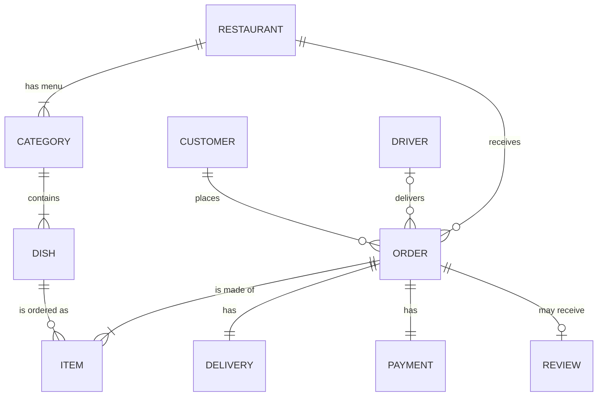

# Modelling Document - Restaurant / Meal-Delivery Platform

**TP1 - SOA Architecture & Web Services - LSI3 - Faculty of Sciences of Sfax - 2025/2026**
**Deliverable:** document explaining the modelling (structure, choices, XPath query examples)

---

## 1. Context and goal

The chosen domain is an **online restaurant and meal-delivery platform** (similar to Uber Eats or Glovo).
Restaurants publish menus, customers place orders, drivers deliver them, and customers can review the result.

This domain was chosen because it is:

* **rich in relationships** (an order links four different entities), which makes XML modelling and XPath joins interesting;
* **full of realistic constraints** (statuses, prices, ratings, allergens, opening hours) that an XSD can enforce;
* **close to real SOA systems**: a delivery platform exchanges exactly this kind of data between services (restaurant service, order service, delivery service, payment service).

The model is stored in `restaurant-delivery.xml`, validated by `restaurant-delivery.xsd`, and queried with XPath from Java (JAXP).

---

## 2. Entities and relationships



| Entity | Cardinality notes |
|---|---|
| **Restaurant** | owns exactly one menu, one address, one opening-hours table |
| **Category / Dish** | a menu has 1..n categories; a category has 1..n dishes |
| **Customer** | 1..n delivery addresses; may be active or inactive |
| **Driver** | has a vehicle; status available / busy / offline |
| **Order** | exactly 1 customer, 1 restaurant; 0..1 driver (none while pending or cancelled); 1..n items |
| **Item** | one order line: which dish, how many, at which unit price |

---

## 3. Structure of the XML document

```
foodDelivery  [version?, generatedOn?]
├── restaurants
│   └── restaurant+  [id, status]
│       ├── name, cuisine
│       ├── address (street, city, postalCode, country?)
│       ├── phone, email?, rating, deliveryRadiusKm, minimumOrder@currency
│       ├── openingHours
│       │   └── day{1..7}  [name, open, close]
│       └── menu
│           └── category+  [name]
│               └── dish+  [id, available, vegetarian, spicy?]
│                   ├── name, description?
│                   ├── price@currency
│                   ├── promotion?  [discountPercent, validUntil]
│                   ├── calories?
│                   └── allergens? / allergen+
├── customers
│   └── customer+  [id, active]
│       ├── firstName, lastName, email, phone
│       ├── address+ [label?]
│       └── loyaltyPoints, registeredOn
├── drivers
│   └── driver+  [id, status]
│       ├── name, phone, vehicle[kind]/plate, rating
└── orders
    └── order*  [id, customerRef, restaurantRef, driverRef?, status]
        ├── orderDate
        ├── items / item+  [dishRef, quantity, unitPrice]  (note?)
        ├── delivery (address, fee@currency, estimatedMinutes, deliveredAt?)
        ├── payment [method, status] / amount@currency
        └── review? [stars] / comment?
```
`?` optional, `+` one or more, `*` zero or more, `[...]` attributes.

Size of the sample data: **5 restaurants, 22 dishes (13 categories), 5 customers, 4 drivers, 10 orders**,
covering every order status (pending, confirmed, on_the_way, delivered, cancelled).

---

## 4. Modelling choices (and why)

### 4.1 Nesting versus references
| Relationship | Choice | Reason |
|---|---|---|
| Restaurant -> menu -> category -> dish | **nested** | a dish makes no sense without its restaurant; one read gives the whole menu |
| Order -> items, delivery, payment, review | **nested** | they live and die with the order |
| Order -> customer / restaurant / driver | **reference by id** (`customerRef`, ...) | these entities exist independently and are shared by many orders; copying them would duplicate data and create inconsistencies |
| Item -> dish | **reference by id** (`dishRef`) | the dish belongs to a menu; the item only records the choice |

### 4.2 Attributes versus elements
* **Attributes** for identifiers, states and flags: `id`, `status`, `active`, `available`, `vegetarian`, `currency`.
  They are atomic, short, and perfect for XPath filters (`[@status='open']`).
* **Elements** for descriptive or structured data: `name`, `address`, `price`, `allergens`.
  They can grow (address has sub-parts) and keep a defined order.

### 4.3 Identifiers
Each entity has a prefix so an id explains itself when read in a query result:
`R001` restaurant, `D001` dish, `C001` customer, `DR001` driver, `O1001` order.
The XSD enforces the pattern (`R\d{3}`, `D\d{3}`, ...).

### 4.4 Price snapshot
`item/@unitPrice` stores the price **at the time of the order**. In a real platform the menu price changes
over time while the history of orders must stay unchanged. (Here, business rule R2 checks that the snapshot
matches the current menu price in the sample data.)

### 4.5 Optional parts
* `driverRef` is optional: a pending or cancelled order has no driver yet.
* `deliveredAt` is optional: only delivered orders have it.
* `review` is optional: not every customer leaves a review.
* `promotion` is optional: only some dishes are discounted.

### 4.6 No namespace
The schema has no `targetNamespace`. This keeps XPath expressions short (`//dish/name`) which suits a teaching
project. In a real SOA exchange you would add a namespace (e.g. `urn:fss:soa:fooddelivery`) and use a
`NamespaceContext` in the XPath code.

---

## 5. The XSD schema: what it enforces

| Mechanism | Example in the schema | Rejected example |
|---|---|---|
| **Structure / order** (`xs:sequence`) | `dish`: name, description?, price, promotion?, ... | `<phone>` before `<address>` |
| **Cardinality** (`minOccurs`/`maxOccurs`) | at least 1 category per menu; at most 7 `day` elements | restaurant without `<name>` |
| **Required / optional attributes** | `id` and `status` required on restaurant | order without `status` |
| **Enumerations** | order status, payment method, allergen, cuisine, day names | `status="shipped"` |
| **Patterns** (regex) | ids, e-mail, phone, postal code, `HH:MM` | `id="CUST-4"`, e-mail `mohamed.ali.at.example` |
| **Numeric ranges** | rating 0..5, stars 1..5, discount 1..90, quantity 1..20 | rating `7.5`, quantity `0` |
| **Positive amounts / decimals** | price > 0 with max 2 decimals | price `-11.00` |
| **Typed dates** | `xs:date`, `xs:dateTime` | `2026-13-45` |
| **Primary keys** (`xs:key`) | restaurant, dish, customer, driver, order ids | two dishes with id `D017` |
| **Foreign keys** (`xs:keyref`) | customerRef, restaurantRef, driverRef, dishRef | `restaurantRef="R999"` |
| **Local uniqueness** (`xs:unique`) | category names unique in a menu; day names unique in the hours | two `Monday` entries |
| **Default value** | `spicy` defaults to `false` | - |

### What the XSD cannot check -> business rules in Java
XSD 1.0 cannot compare two values from different places. These rules are checked by `BusinessRulesChecker`
using XPath:

| Rule | Description |
|---|---|
| R1 | every ordered dish belongs to the menu of the order's restaurant |
| R2 | `unitPrice` equals the menu price of the dish |
| R3 | `payment/amount` = sum(`quantity` x `unitPrice`) + `delivery/fee` |
| R4 | a `delivered` order has a `driverRef` and a `deliveredAt` |
| R5 | a `cancelled` order has no driver and its payment is not `paid` |

(XSD 1.1 offers `xs:assert` for this, but the JDK validator supports XSD 1.0 only - so Java + XPath is the portable answer.)

---

## 6. Java implementation (summary)

| Class | Responsibility | JAXP API used |
|---|---|---|
| `XmlValidator` | Feature 1 - validates a document, collects **all** errors with line/column | `SchemaFactory`, `Schema`, `Validator`, `ErrorHandler` |
| `XPathQueryService` | Feature 2 - loads the DOM and evaluates XPath (4 result types) | `DocumentBuilderFactory`, `XPathFactory`, `XPathExpression` |
| `QueryCatalog` | 51 documented queries | - |
| `BusinessRulesChecker` | rules R1..R5 | XPath on DOM nodes |
| `Main` | modes: all, validate, xpath, rules, suite, interactive | - |

---

## 7. XPath query examples (with the real results of the program)

### 7.1 The three queries suggested by the TP

| TP wording | XPath | Result |
|---|---|---|
| Find all film titles | `//dish/name` | 22 dish names: Pizza Margherita, Pizza Diavola, Spaghetti Carbonara, ... |
| Extract active users | `//customer[@active='true']/email` | sarah.johnson@..., mohamed.ali@..., emma.dubois@..., yasmine.haddad@... |
| List products on promotion | `//dish[promotion]/name` | Pizza Margherita, Tiramisu, California Roll (8 pcs), Spicy Chicken Burger, Green Detox Smoothie |

### 7.2 Filtering with attributes and values

| Question | XPath | Result |
|---|---|---|
| Restaurants currently open | `//restaurant[@status='open']/name` | Bella Napoli Pizzeria, Sakura Sushi House, Burger Republic, Beirut Nights |
| Vegetarian dishes available now | `//dish[@vegetarian='true' and @available='true']/name` | 13 dishes |
| Dishes costing more than 12 EUR | `//dish[price > 12]/name` | Spaghetti Carbonara, Salmon Nigiri Set, Chicken Ramen, Spicy Chicken Burger, Buddha Bowl, Chicken Shawarma Plate |
| Dishes with 15% discount or more | `//dish[promotion/@discountPercent >= 15]/name` | Pizza Margherita, California Roll, Spicy Chicken Burger |
| Dishes with no allergen | `//dish[not(allergens/allergen)]/name` | Iced Green Tea, Sweet Potato Fries, Green Detox Smoothie |
| Vegetarian and gluten-free | `//dish[@vegetarian='true' and not(allergens/allergen='gluten')]/name` | 6 dishes |

### 7.3 Aggregates

| Question | XPath | Result |
|---|---|---|
| Number of dishes | `count(//dish)` | 22 |
| Revenue of delivered orders | `sum(//order[@status='delivered']/payment/amount)` | 218.90 EUR |
| Average dish price | `sum(//dish/price) div count(//dish)` | 9.45 EUR |
| Cheapest dish (XPath 1.0 "min") | `//dish[not(price > //dish/price)]/name` | Iced Green Tea |
| Most expensive dish (XPath 1.0 "max") | `//dish[not(price < //dish/price)]/name` | Salmon Nigiri Set |

### 7.4 Joins through ids (the XML equivalent of SQL JOIN)

| Question | XPath | Result |
|---|---|---|
| Restaurant of order O1001 | `//restaurant[@id = //order[@id='O1001']/@restaurantRef]/name` | Bella Napoli Pizzeria |
| Dishes ordered in O1001 | `//dish[@id = //order[@id='O1001']/items/item/@dishRef]/name` | Pizza Margherita, Spaghetti Carbonara, Tiramisu |
| Customers who gave 5 stars | `//customer[@id = //order[review/@stars=5]/@customerRef]/lastName` | Johnson, Dubois, Haddad |
| Dishes never ordered | `//dish[not(@id = //item/@dishRef)]/name` | Matcha Mochi, Veggie Garden Burger, Falafel Wrap |
| Orders without driver | `//order[not(@driverRef)]/@id` | O1005, O1006, O1007 |

### 7.5 Axes, position, union

| Question | XPath | Result |
|---|---|---|
| Restaurant that owns dish D007 | `//dish[@id='D007']/ancestor::restaurant/name` | Sakura Sushi House |
| Dish following D001 | `//dish[@id='D001']/following-sibling::dish[1]/name` | Pizza Diavola |
| Restaurants closed on Sunday | `//restaurant[not(openingHours/day[@name='Sunday'])]/name` | Burger Republic, Green Garden Vegan Kitchen |
| Spicy OR promoted dishes | `//dish[@spicy='true']/name \| //dish[promotion]/name` | 8 dishes (union, no duplicates) |

The complete list with all 51 queries is in [`output/xpath-report.txt`](../output/xpath-report.txt)
and in [`QueryCatalog.java`](../src/main/java/com/fss/soa/tp1/QueryCatalog.java).

---

## 8. Validation results

| Document | Verdict |
|---|---|
| `restaurant-delivery.xml` | **VALID** |
| 10 files in `xml/invalid/` | all **rejected** (9 violate the schema, 1 is not even well-formed) - see [`05-VALIDATION-FILES.md`](05-VALIDATION-FILES.md) |
| Business rules R1..R5 | 67 checks, 0 violation |

---

## 9. Limits and possible improvements

* **Namespace:** add `targetNamespace` for real-world exchange.
* **XSD 1.1:** use `xs:assert` to move rules R2-R5 into the schema (needs a Saxon or Xerces-1.1 validator).
* **Time rules:** check that an order is placed inside the restaurant's opening hours.
* **Scalability:** DOM loads the whole file in memory; for very large files use StAX or SAX.
* **XPath 2.0/3.1:** with Saxon-HE you could use `distinct-values()`, `min()`, `max()`, `string-join()`.
* **Next step in the course:** expose these operations as a SOAP / REST web service, using this XML as the message format.
